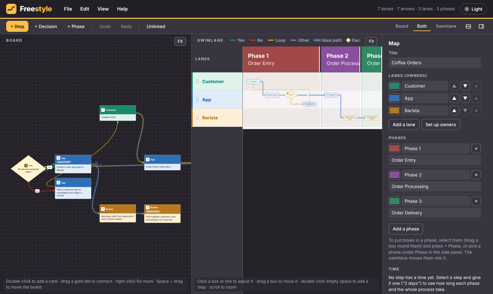
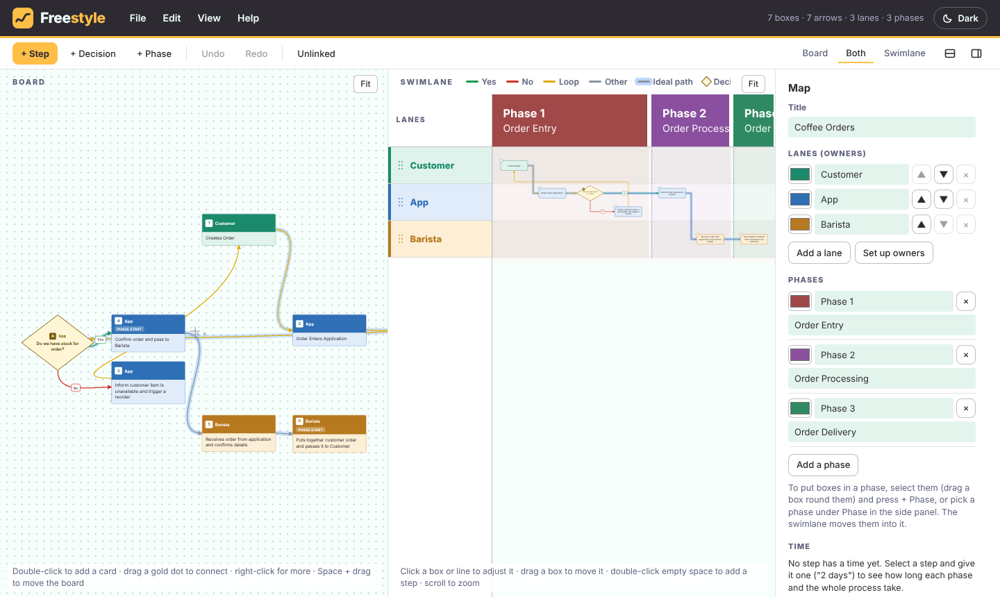

# Freestyle

Sketch a process on a free board and get a print-ready swimlane diagram of it: lanes for owners, time left to
right, phases, Yes / No / Loop arrow colours, an ideal-path glow and numbered steps.

It is one HTML file. It runs in your browser, and nothing you draw is uploaded anywhere.

## Use it

Open `index.html` in a browser. That is all; there is nothing to install and no account.

- **Draw:** double-click the board to add a card, drag a gold dot to connect two cards, and pick each card's owner.
  The swimlane beside the board follows as you go. With a step or an arrow selected, **+ Step** and **+ Decision**
  put the new box straight after it, joined in.
- **Menus:** File (new, open, save, JSON, print, PDF, images, the example), Edit (undo, redo, add, owners), View
  (viewer mode, high contrast) and Help sit in the header. The toolbar keeps the everyday buttons, the Board / Both /
  Swimlane tabs, the stacked layout and a switch to hide the side panel.
- **Unlinked:** outlines every box that is missing an arrow in or out, and lists them in the side panel.
- **Keys on a step:** a time it takes ("2 days", "4-5 weeks"), a cutoff time, something broken, a note (a small cloud
  that opens when you point at it) and a link. The Map panel adds the times up for each phase and the whole process.
- **The swimlane:** phase names and lane names stay put while you move around. Drag a lane by its grip to reorder,
  drag a box to move it, and double-click empty space to add a step there.
- **Save and open:** **Save file** downloads the map to your computer as a `.map.json` file. **Open file** loads one
  back, and so does dropping the file on the board. **Copy or paste JSON** shows the same thing as text.
- **Get it out:** print one page per phase, print the whole process on one wide page, download a PDF, or copy PNG
  images. Printed pages list the problems and notes under the swimlane.
- **Look only:** View, Open in viewer mode opens the map in a new tab where nothing can be changed (`?mode=view`;
  `?mode=embed` shows just the swimlane).
- **Light and dark:** the button in the top right switches. It follows your system until you choose.
- **Help** lists every convention (decisions, Yes / No labels, phases, the ideal path, the keys).

The map on screen is also remembered in your browser between visits, but the file you save is the copy to keep.

It can also import an Arcweave project: export the project as JSON and open its `project_settings.json`.

## Change it

Requirements: Python 3 to build. No other tooling.

1. Edit the modules in `app/`:
   - `shell.html`: the page, the styles and the two themes
   - `engine.js`: the map format, the layout and the Arcweave import
   - `render.js`: drawing the swimlane
   - `export.js`: print pages and images
   - `pdf.js`: the PDF download
   - `app.js`: the board, the panel, files and keys
2. Run `python build.py`. It joins them, with the example in `examples/coffee-orders.map.json`, into `index.html`.

To host it, put `index.html` on any static host (GitHub Pages works).

## Palette

| Name | Hex | Used for |
|---|---|---|
| Shadow grey | `#2d2a32` | header, dark background, text on light |
| Lavender grey | `#7c809b` | secondary text and quiet details |
| Mint cream | `#f1fffa` | light background, text on dark |
| Sunflower gold | `#ffbf46` | the main button, selection, connection dots |
| Golden pollen | `#fdca40` | hover on gold |

The colours inside the diagram itself (lane colours, green Yes, red No, yellow Loop, the blue ideal-path glow) are
part of how the diagram is read, and are the same in both themes. The swimlane is drawn on white, like the page it
prints on.

## Notes

- The map file format is plain JSON: `lanes`, `phases`, `nodes` (cards) and `edges` (arrows). Maps written by
  earlier versions of this tool still open.
- Not built yet: opening an Arcweave zip directly, a phase region drawn on the board, and splitting a very long
  phase over several pages.
